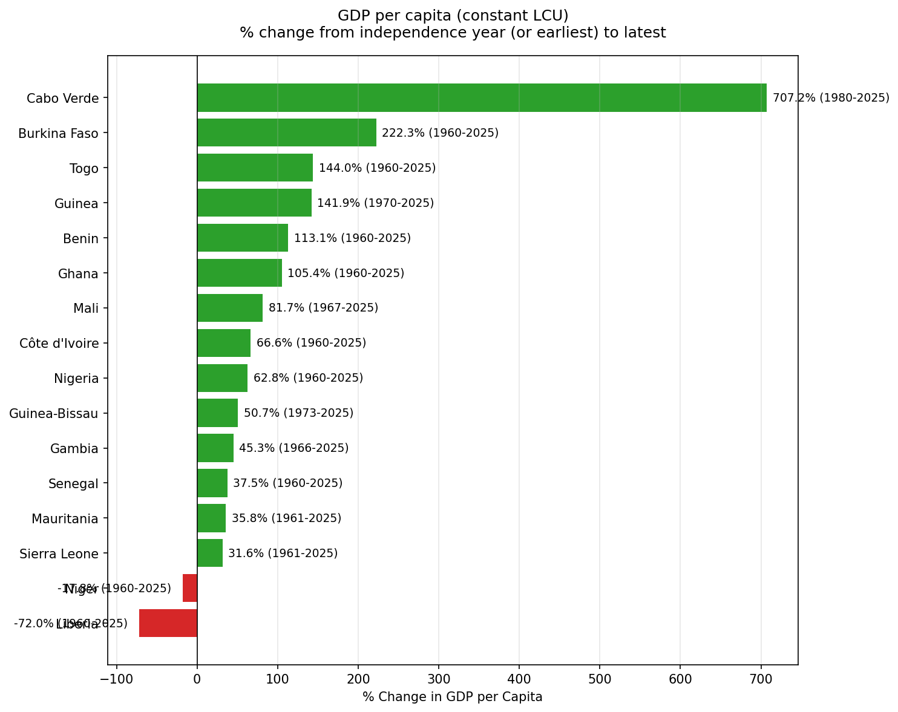
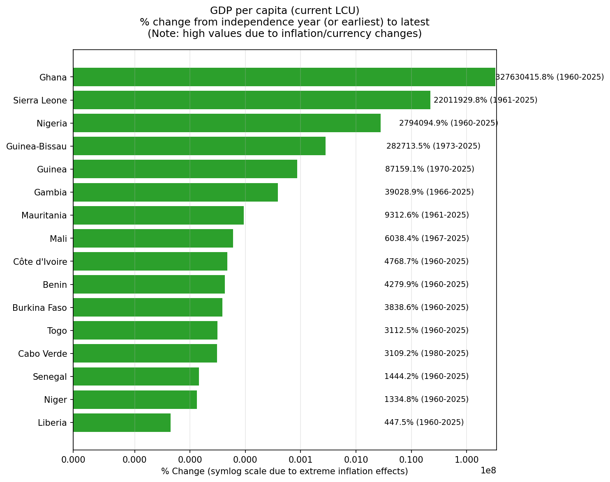
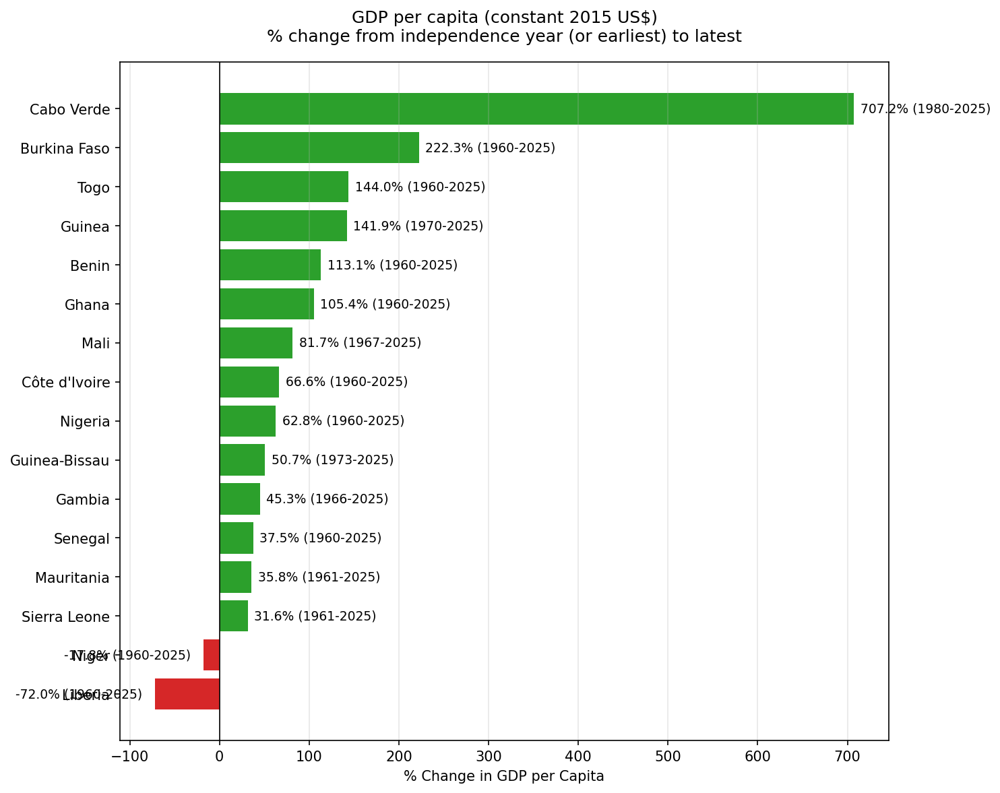
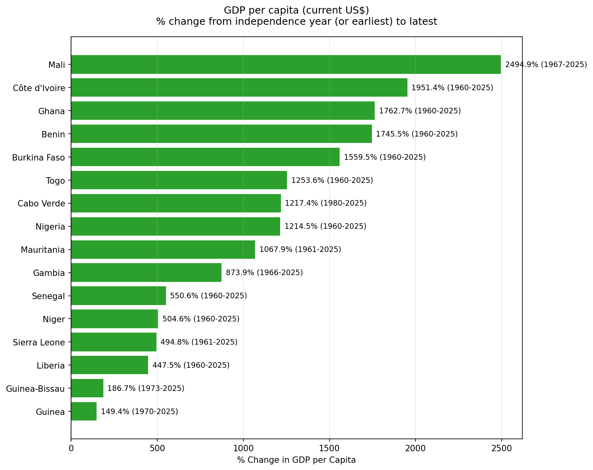
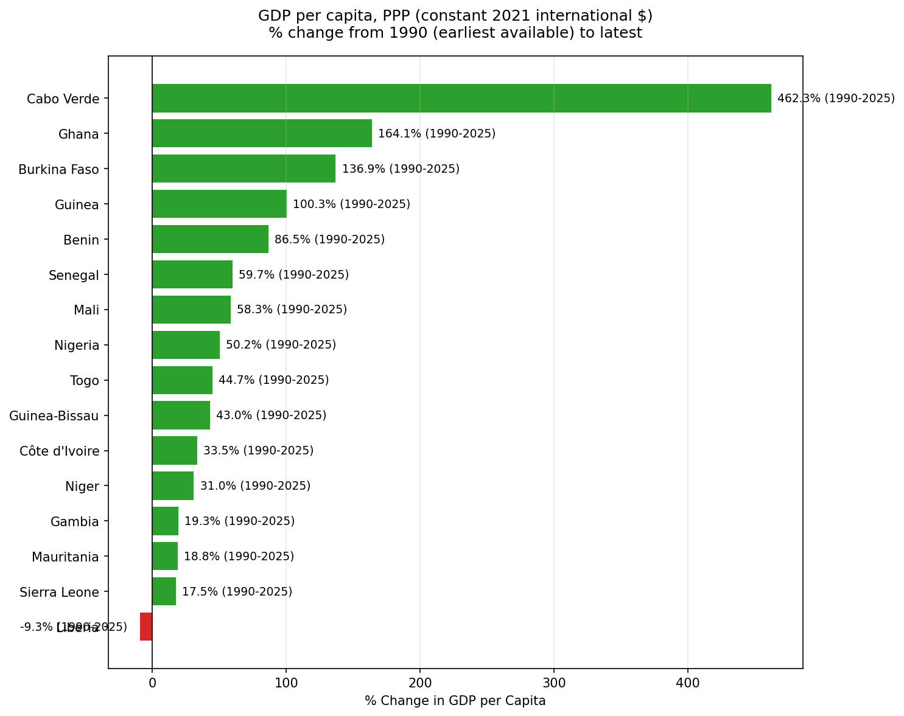
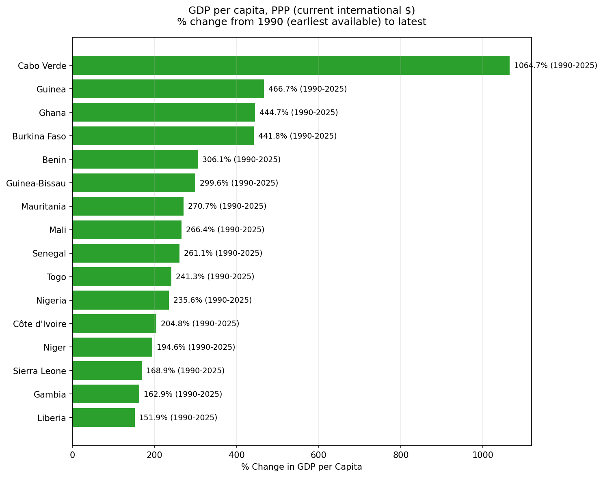

# GDP per Capita Change in West Africa: Independence to 2025

Percentage change in GDP per capita for the 16 West African countries from their year of independence (or the earliest year with available data) to the latest available year (typically 2025).

Six different World Bank series are compared. Each chart is sorted by percentage change (highest at the top). Positive changes are shown in green; negative changes in red. The period used for each country is labeled on the bars.

## Countries and Independence Years

| Country | Code | Independence Year |
|---------|------|-------------------|
| Benin | BEN | 1960 |
| Burkina Faso | BFA | 1960 |
| Cabo Verde | CPV | 1975 |
| Côte d'Ivoire | CIV | 1960 |
| Gambia | GMB | 1965 |
| Ghana | GHA | 1957 |
| Guinea | GIN | 1958 |
| Guinea-Bissau | GNB | 1973 |
| Liberia | LBR | 1847 |
| Mali | MLI | 1960 |
| Mauritania | MRT | 1960 |
| Niger | NER | 1960 |
| Nigeria | NGA | 1960 |
| Senegal | SEN | 1960 |
| Sierra Leone | SLE | 1961 |
| Togo | TGO | 1960 |

**Notes on base years**
- Where data exist for the independence year, that year is used as the starting point.
- Otherwise the earliest subsequent year with positive data is used (e.g., Cabo Verde constant-price series begin in 1980; most PPP series begin in 1990).
- Liberia’s formal independence was in 1847, but usable series start in 1960.

## Why the Leading Country Differs by Series

| Series | Top country | Reason |
|--------|-------------|--------|
| Constant LCU & Constant 2015 US$ | Cabo Verde (~+707%) | Real (inflation-adjusted) growth |
| Current LCU | Ghana (extreme) | Nominal; tiny base values from old currency units + high inflation |
| Current US$ | Mali (~+2,495%) | Nominal dollars; influenced by exchange-rate movements |
| PPP (constant & current) | Cabo Verde | Real growth after adjusting for price-level differences |

Constant-price and PPP series are the most meaningful for assessing changes in living standards. Current-price series are heavily affected by inflation and exchange-rate movements.

## Graphs

### 1. GDP per capita (constant LCU)
Real growth in local currency units. Identical percentage changes to the constant 2015 US$ series.

**Source:** [World Bank – GDP per capita (constant LCU)](https://data.worldbank.org/indicator/NY.GDP.PCAP.KN)

### 2. GDP per capita (current LCU)
Nominal local-currency values. Extreme percentage changes for some countries (especially Ghana, Sierra Leone, and Nigeria) result from high inflation and currency redenominations that produced very small base-year values. Chart uses a symlog scale.

**Source:** [World Bank – GDP per capita (current LCU)](https://data.worldbank.org/indicator/NY.GDP.PCAP.CN)

### 3. GDP per capita (constant 2015 US$)
Real growth expressed in constant 2015 U.S. dollars. Percentage changes match the constant LCU series.

**Source:** [World Bank – GDP per capita (constant 2015 US$)](https://data.worldbank.org/indicator/NY.GDP.PCAP.KD)

### 4. GDP per capita (current US$)
Nominal values in current U.S. dollars. Rankings reflect both real growth and exchange-rate movements.

**Source:** [World Bank – GDP per capita (current US$)](https://data.worldbank.org/indicator/NY.GDP.PCAP.CD)

### 5. GDP per capita, PPP (constant 2021 international $)
Real growth in purchasing-power-parity terms (constant 2021 international dollars). Most series begin in 1990.

**Source:** [World Bank – GDP per capita, PPP (constant 2021 international $)](https://data.worldbank.org/indicator/NY.GDP.PCAP.PP.KD)

### 6. GDP per capita, PPP (current international $)
Nominal PPP values in current international dollars. Most series begin in 1990.

**Source:** [World Bank – GDP per capita, PPP (current international $)](https://data.worldbank.org/indicator/NY.GDP.PCAP.PP.CD)

## Data Sources

All data are from the World Bank’s World Development Indicators (last updated 2026-10-08):

1. [GDP per capita (constant LCU)](https://data.worldbank.org/indicator/NY.GDP.PCAP.KN) — `NY.GDP.PCAP.KN`
2. [GDP per capita (current LCU)](https://data.worldbank.org/indicator/NY.GDP.PCAP.CN) — `NY.GDP.PCAP.CN`
3. [GDP per capita (constant 2015 US$)](https://data.worldbank.org/indicator/NY.GDP.PCAP.KD) — `NY.GDP.PCAP.KD`
4. [GDP per capita (current US$)](https://data.worldbank.org/indicator/NY.GDP.PCAP.CD) — `NY.GDP.PCAP.CD`
5. [GDP per capita, PPP (constant 2021 international $)](https://data.worldbank.org/indicator/NY.GDP.PCAP.PP.KD) — `NY.GDP.PCAP.PP.KD`
6. [GDP per capita, PPP (current international $)](https://data.worldbank.org/indicator/NY.GDP.PCAP.PP.CD) — `NY.GDP.PCAP.PP.CD`

## Summary Data

A complete table of start/end years, values, and percentage changes for every country and series is available in [`gdp_pct_change_summary.csv`](gdp_pct_change_summary.csv).

## Interpretation Notes

- **Constant-price series** (constant LCU and constant 2015 US$) measure real growth and are best for assessing changes in output per person.
- **Current-price series** include inflation (and, for US$ and PPP series, exchange-rate or price-level effects).
- **PPP series** adjust for differences in price levels across countries and are preferable for comparing living standards.
- Cabo Verde shows the strongest real gains. Niger and Liberia show declines in real terms over the full period.
- Extreme values in the current LCU series should not be interpreted as real economic progress.

## License / Attribution

Data: World Bank World Development Indicators.  
Charts and analysis prepared for public sharing.
